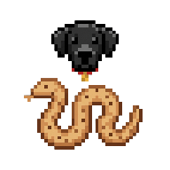
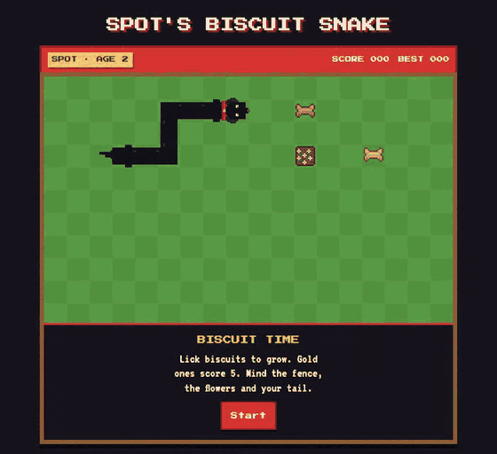

<div align="center">



# Spot's Biscuit Snake

**A snake game in one HTML file, starring Spot the black labrador.**

[Play](#play) · [Controls](#controls) · [AI plays](#ai-plays) · [What it stores](#what-it-stores) · [Credits](#licence-and-credits)




</div>

Spot is a two-year-old black labrador with a red collar. Lick biscuits to grow; gold ones score 5. Mind the fence, the flowers and your own tail.

<!-- run-steps:start -->
## Run it locally, step by step

1. **Get the code:**

   ```sh
   git clone https://github.com/Gitguy268/spot-snake.git
   cd spot-snake
   ```

2. **Open `index.html`** by double-clicking it. There is nothing to install or build.
<!-- run-steps:end -->

## Play

Clone or download this repository, then open `index.html` in a browser. There is nothing to install or build.

## Controls

| Input | What it does |
| --- | --- |
| <kbd>↑</kbd> <kbd>↓</kbd> <kbd>←</kbd> <kbd>→</kbd> or <kbd>W</kbd> <kbd>A</kbd> <kbd>S</kbd> <kbd>D</kbd> | Steer |
| <kbd>Space</kbd> | Pause and resume |
| <kbd>M</kbd> | Change the sound: all, effects only, off |
| Gamepad: d-pad or left stick; <kbd>A</kbd> or <kbd>Start</kbd> | Steer; pause and resume. A pad with a motor rumbles on a crash and on a golden biscuit |
| Swipe on the lawn, or the on-screen pad | Steer on a phone |
| **AI plays** | Spot steers himself. Any steering key, swipe or a second press takes over again |

There are three speeds: **Puppy**, **Normal** and **Zoomies**. Pick one before you start. Spot speeds up as the biscuits add up.

## AI plays

Press **AI plays** and Spot steers himself. The moves are picked by
[Laya](https://huggingface.co/convaiinnovations/laya), a small decision model by Convai Innovations. Laya doesn't write
text; it scores a list of options. Each step, the game works out which moves don't crash Spot, which of those leave
him enough room, and which of those bring him closer to the biscuit. It describes each move that is left ("goes toward
the biscuit, leaves 212 open squares") and Laya picks one. Laya on its own tends to walk in circles, which is why the
game narrows its options first.

- It needs **WebGPU** (tested in Chromium; current Chrome, Edge and Brave have it). Without it the button is greyed out.
- The first press downloads the model, about 851 MB, from Hugging Face ([`onnx-community/laya-ONNX`](https://huggingface.co/onnx-community/laya-ONNX), fp16) and keeps it in the browser's Cache Storage. Later presses start in a few seconds.
- Each choice takes a moment on the GPU, so Spot waits on each square while Laya thinks. The speed buttons don't apply.

## What it stores

The best score for each speed, the speed you picked and your sound setting are kept in the browser's `localStorage`. The page loads its two fonts from Google Fonts; without a connection it falls back to the fonts on your device. Nothing else is fetched until you press **AI plays**. That press loads ONNX Runtime Web and tokenizers.js from jsDelivr and the Laya model from Hugging Face. The model is kept in Cache Storage (`laya-v1`); clearing the site's data removes it.

## Contributing

Bug reports and pull requests are welcome. See [CONTRIBUTING.md](CONTRIBUTING.md) and the [Code of Conduct](CODE_OF_CONDUCT.md). Report security problems privately, as [SECURITY.md](SECURITY.md) describes.

## Licence and credits

[MIT](LICENSE) © Lucas Van De Weerd.

The game builds on ideas from two open-source snake games and one game framework. Their licences are in [NOTICE](NOTICE).

- [epidemian/snake](https://github.com/epidemian/snake) (Unlicense): the input queue with its opposite-direction check, the tail leaving a cell before the head arrives, food dropped only on empty cells, the speed ramp, the high score in `localStorage`, and pausing when the window loses focus.
- [janbodnar/Java-Snake-Game](https://github.com/janbodnar/Java-Snake-Game) (BSD-2-Clause): the head, body and food sprite model on a fixed tile grid with solid walls.
- [Phaser](https://github.com/phaserjs/phaser) (MIT): the gamepad button numbers of the standard layout, a button or stick counting once it is pushed past halfway, and the crumbs that fly off a biscuit (thrown out at once at random angles and speeds, pulled down by gravity, gone after a fixed lifespan).

The AI player runs [Laya](https://huggingface.co/convaiinnovations/laya) (Apache-2.0, Convai Innovations) through [ONNX Runtime Web](https://github.com/microsoft/onnxruntime) (MIT) and [tokenizers.js](https://github.com/huggingface/tokenizers.js) (Apache-2.0). The way its input is laid out is ported from laya's `rl_common.py`; see [NOTICE](NOTICE).

The fonts are [Press Start 2P](https://fonts.google.com/specimen/Press+Start+2P) and [VT323](https://fonts.google.com/specimen/VT323), both under the SIL Open Font License 1.1. They are loaded from Google Fonts and are not part of this repository. All artwork and sound is drawn and synthesised in the page.
